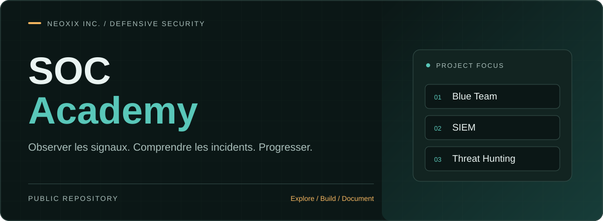

<!-- BEGIN NEOXIX REPOSITORY PRESENTATION -->
<p align="left">
  
</p>

<p align="left"><strong>Parcours pratique et documentation de laboratoires en cybersécurité défensive.</strong></p>

<p align="left"></p>

<p align="left"><a href="01-Wireshark">Wireshark</a> &nbsp; / &nbsp; <a href="02-Wazuh">Wazuh</a> &nbsp; / &nbsp; <a href="ROADMAP.md">Feuille de route</a></p>
<!-- END NEOXIX REPOSITORY PRESENTATION -->

---

<div align="center">

# 🛡️ Neoxix SOC Academy


<br>

[](https://github.com/Neoxix-Inc)


**Français · English**

[🇫🇷 Version française](#-version-française) • [🇬🇧 English version](#-english-version)

</div>

---

# 🇫🇷 Version française

## Présentation

**Neoxix SOC Academy** est un portfolio technique professionnel consacré à l’administration réseau, à l’administration système, à la cybersécurité défensive et aux opérations d’un centre opérationnel de sécurité — **SOC**.

Le dépôt documente une progression pratique à travers des laboratoires réalistes, des analyses techniques, des fichiers PCAP, des scripts, des diagrammes, des rapports d’incident et des preuves de compétences.

## Objectifs professionnels

Ce projet vise à démontrer des compétences concrètes pour des postes tels que :

* analyste SOC ;
* analyste en cybersécurité ;
* administrateur réseau ;
* administrateur système ;
* technicien en sécurité informatique ;
* analyste Blue Team ;
* analyste en réponse aux incidents.

L’objectif principal est de construire un portfolio vérifiable pouvant être présenté directement à des recruteurs avant **décembre 2026**.

## Technologies et disciplines

| Domaine                | Technologies et compétences                               |
| ---------------------- | --------------------------------------------------------- |
| Analyse réseau         | Wireshark, PCAP, TCP/IP, DNS, HTTP, TLS, ICMP, ARP        |
| SIEM                   | Wazuh, Splunk                                             |
| Sécurité des endpoints | CrowdStrike, Sysmon, Microsoft Defender                   |
| Détection des menaces  | IOC, règles de détection, corrélation d’événements        |
| Threat Hunting         | Hypothèses de chasse, recherche d’anomalies, MITRE ATT&CK |
| Réponse aux incidents  | Identification, confinement, éradication, récupération    |
| Blue Team              | Surveillance, analyse, défense et documentation           |
| Automatisation         | PowerShell, scripts, GitHub Actions                       |
| Réseau                 | Cisco CCNA 200-301                                        |
| Sécurité réseau        | Fortinet NSE 4                                            |

## Technologies utilisées · Technologies used

<div align="center">


&nbsp;&nbsp;

&nbsp;&nbsp;

&nbsp;&nbsp;

&nbsp;&nbsp;

&nbsp;&nbsp;

&nbsp;&nbsp;

&nbsp;&nbsp;

&nbsp;&nbsp;

&nbsp;&nbsp;

&nbsp;&nbsp;

&nbsp;&nbsp;


<br><br>

**Wireshark · Wazuh · Splunk · CrowdStrike · Windows · PowerShell · Cisco · Fortinet · GitHub · Git · Visual Studio Code · Linux**

</div>

## Structure du dépôt

```text
neoxix-soc-academy
├── .github
├── 00-Environment
├── 01-Wireshark
├── 02-Wazuh
├── 03-Splunk
├── 04-CrowdStrike
├── 05-Incident-Response
├── 06-Threat-Hunting
├── 07-Final-Projects
├── 08-Portfolio
├── 09-CCNA
├── 10-Fortinet-NSE4
├── docs
├── diagrams
├── scripts
├── templates
├── CHANGELOG.md
├── LICENSE
├── README.md
└── ROADMAP.md
```

## Méthodologie des laboratoires

Chaque laboratoire doit inclure :

* les objectifs techniques ;
* les compétences évaluées ;
* les prérequis ;
* la topologie réseau ;
* la procédure d’exécution ;
* les commandes utilisées ;
* les filtres Wireshark ou requêtes SIEM ;
* l’analyse des résultats ;
* les preuves et captures d’écran ;
* les indicateurs de compromission ;
* les difficultés rencontrées ;
* les leçons apprises ;
* les recommandations de sécurité.

## Premier module — Wireshark

Le premier module porte sur l’analyse réseau avec Wireshark.

### Premier laboratoire

```text
LAB-01-Network-Traffic-Baseline
```

Ce laboratoire permettra :

* de capturer du trafic réseau normal ;
* d’identifier les protocoles principaux ;
* d’analyser les communications entre les hôtes ;
* de créer une référence de trafic légitime ;
* de préparer la détection de comportements suspects.

## Progression du projet

| Phase | Module                | État              |
| ----: | --------------------- | ----------------- |
|     1 | Architecture du dépôt | 🟡 En cours       |
|     2 | Wireshark             | 🟡 En préparation |
|     3 | Wazuh                 | ⚪ Planifié        |
|     4 | Splunk                | ⚪ Planifié        |
|     5 | CrowdStrike           | ⚪ Planifié        |
|     6 | Incident Response     | ⚪ Planifié        |
|     7 | Threat Hunting        | ⚪ Planifié        |
|     8 | Projets SOC finaux    | ⚪ Planifié        |
|     9 | CCNA                  | ⚪ Planifié        |
|    10 | Fortinet NSE4         | ⚪ Planifié        |

Consultez le fichier [ROADMAP.md](ROADMAP.md) pour suivre l’évolution détaillée du projet.

## Sécurité et confidentialité

Ce dépôt ne doit jamais contenir :

* de mots de passe ;
* de jetons d’accès ;
* de clés privées ;
* de secrets d’API ;
* de certificats confidentiels ;
* de captures réseau provenant d’un environnement de production ;
* de données personnelles sensibles ;
* d’informations internes appartenant à une organisation.

Toutes les données publiées doivent provenir d’environnements de laboratoire contrôlés et autorisés.

---

# 🇬🇧 English version

## Overview

**Neoxix SOC Academy** is a professional technical portfolio focused on network administration, system administration, defensive cybersecurity and Security Operations Center activities.

The repository documents practical progression through realistic laboratories, technical analyses, PCAP files, scripts, diagrams, incident reports and verifiable evidence of technical skills.

## Professional objectives

This project is designed to demonstrate practical competencies for roles such as:

* SOC analyst;
* cybersecurity analyst;
* network administrator;
* system administrator;
* information security technician;
* Blue Team analyst;
* incident response analyst.

The main objective is to build a verifiable technical portfolio that can be presented directly to recruiters before **December 2026**.

## Technologies and disciplines

| Domain            | Technologies and skills                             |
| ----------------- | --------------------------------------------------- |
| Network analysis  | Wireshark, PCAP, TCP/IP, DNS, HTTP, TLS, ICMP, ARP  |
| SIEM              | Wazuh, Splunk                                       |
| Endpoint security | CrowdStrike, Sysmon, Microsoft Defender             |
| Threat detection  | IOC, detection rules, event correlation             |
| Threat hunting    | Hunting hypotheses, anomaly detection, MITRE ATT&CK |
| Incident response | Identification, containment, eradication, recovery  |
| Blue Team         | Monitoring, investigation, defense and reporting    |
| Automation        | PowerShell, scripting, GitHub Actions               |
| Networking        | Cisco CCNA 200-301                                  |
| Network security  | Fortinet NSE 4                                      |

## Repository structure

```text
neoxix-soc-academy
├── .github
├── 00-Environment
├── 01-Wireshark
├── 02-Wazuh
├── 03-Splunk
├── 04-CrowdStrike
├── 05-Incident-Response
├── 06-Threat-Hunting
├── 07-Final-Projects
├── 08-Portfolio
├── 09-CCNA
├── 10-Fortinet-NSE4
├── docs
├── diagrams
├── scripts
├── templates
├── CHANGELOG.md
├── LICENSE
├── README.md
└── ROADMAP.md
```

## Laboratory methodology

Each laboratory must include:

* technical objectives;
* evaluated skills;
* prerequisites;
* network topology;
* implementation procedure;
* commands used;
* Wireshark filters or SIEM queries;
* result analysis;
* screenshots and technical evidence;
* indicators of compromise;
* encountered difficulties;
* lessons learned;
* security recommendations.

## First module — Wireshark

The first module focuses on network traffic analysis using Wireshark.

### First laboratory

```text
LAB-01-Network-Traffic-Baseline
```

This laboratory will be used to:

* capture normal network traffic;
* identify common protocols;
* analyze host communications;
* establish a legitimate traffic baseline;
* prepare for suspicious behavior detection.

## Project progress

| Phase | Module                  | Status            |
| ----: | ----------------------- | ----------------- |
|     1 | Repository architecture | 🟡 In progress    |
|     2 | Wireshark               | 🟡 In preparation |
|     3 | Wazuh                   | ⚪ Planned         |
|     4 | Splunk                  | ⚪ Planned         |
|     5 | CrowdStrike             | ⚪ Planned         |
|     6 | Incident Response       | ⚪ Planned         |
|     7 | Threat Hunting          | ⚪ Planned         |
|     8 | Final SOC projects      | ⚪ Planned         |
|     9 | CCNA                    | ⚪ Planned         |
|    10 | Fortinet NSE4           | ⚪ Planned         |

See [ROADMAP.md](ROADMAP.md) for the detailed project roadmap.

## Security and privacy

This repository must never contain:

* passwords;
* access tokens;
* private keys;
* API secrets;
* confidential certificates;
* production network captures;
* sensitive personal information;
* confidential organizational data.

All published data must originate from controlled and authorized laboratory environments.

---

## Documentation

* [Project roadmap](ROADMAP.md)
* [Project changelog](CHANGELOG.md)
* [MIT License](LICENSE)
* [Documentation index](docs/README.md)
* [Reusable templates](templates/README.md)
* [Repository rules for AI assistants](CLAUDE.md)
* [Wireshark module](01-Wireshark/README.md)
* [First Wireshark laboratory](01-Wireshark/01-Labs/LAB-01-Network-Traffic-Baseline/README.md)

## Author

**Kodjo Mathias Akah**
Founder — **Neoxix Inc.**

GitHub organization: [Neoxix-Inc](https://github.com/Neoxix-Inc)

---

<div align="center">

### Building practical cybersecurity skills, one laboratory at a time.

### Développer des compétences pratiques en cybersécurité, un laboratoire à la fois.


</div>
